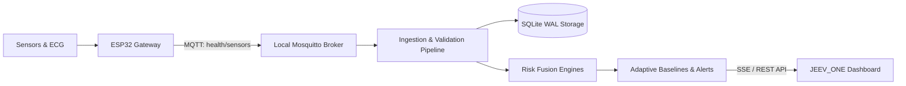

<div align="center">
  
  <h1>JEEV_ONE</h1>
  <h3>Spectrona Autonomous Edge Health Monitoring &amp; ECG Level 1 Telemetry Node</h3>

  <p>
    <a href="#license"></a>
    <a href="#python"></a>
    <a href="#platform"></a>
    <a href="#offline"></a>
    <a href="#ecg"></a>
  </p>
</div>

---

**JEEV_ONE (Spectrona)** is an advanced, privacy-first edge health monitoring station designed to operate completely offline in disconnected, disaster-prone, or air-gapped environments. 

It acquires multi-parameter physiological vitals and environmental metrics from edge sensors (ESP32), validates and stores readings in a local SQLite database, executes local deterministic AI-assisted risk fusion algorithms (Vital, Thermal, and Respiratory strain), monitors Level 1 ECG diagnostics in real-time, and streams live telemetry to an interactive web dashboard.

> **Privacy & Offline Guarantee:** This system operates 100% locally on edge devices (Raspberry Pi, local server, or workstation). No internet connection or external cloud service is required for core acquisition, risk assessment, or visualization.

---

## Key Features

- **Real-Time Physiological Telemetry:** Continuous acquisition of Heart Rate (BPM), Blood Oxygen (SpO₂), Non-Contact Body Temperature (°C), and Systolic/Diastolic Blood Pressure (mmHg).
- **Environmental Context Awareness:** Ambient room temperature (°C) and relative humidity (%) captured via DHT22 to compute dynamic heat index and thermal strain.
- **Level 1 ECG Oscilloscope & Diagnostics:**
  - Live phosphorescent Lead I sweep monitor (25 mm/s display speed, 250 SPS sampling rate, 50Hz notch filter).
  - Real-time morphological metrics: R-R Interval, PR Interval, QRS Duration, QTc (Bazett's Correction), R-Peak Amplitude, and Rhythm Classification (Normal Sinus vs. Arrhythmia).
  - Dedicated **ECG Diagnostics Archive Tab** with 10-second high-resolution rhythm strip reviewer, calibration pulse, and telemetry CSV exporter.
- **Multi-Tab Edge Dashboard:**
  - 📊 **Live Monitor:** High-frequency dials, oscilloscope chassis, personal baseline deviation gauges, and risk matrix.
  - 📋 **Recent Readings Tab:** Complete chronological telemetry table with alert states and inspection modal.
  - 📈 **ECG Diagnostics Tab:** In-depth ECG strip review, interval analysis, and historical diagnostics registry.
  - ⚙️ **Settings & API Services:** Real-time pipeline health check, API endpoint diagnostics, and interface preferences.
- **Modern Dual Theme:** Seamless switching between high-contrast **OLED Dark Mode** (`#09090b`) and clinical **Light Mode** with instant theme persistence.
- **Edge Storage & Resilient Streaming:** High-performance SQLite database with Write-Ahead Logging (WAL) and Server-Sent Events (SSE) / REST polling fallback.
- **Adaptive Personal Baselines:** Exponential Moving Average (EMA, $\alpha=0.05$) baseline tracking that adapts dynamically to individual resting vitals while rejecting anomalous spikes.

---

## Architecture Overview



- **ESP32 Gateway**: Aggregates multi-sensor I/O over I2C, UART, and One-Wire, serializes JSON packets, and publishes to the local broker.
- **Mosquitto MQTT Broker**: Disconnected local messaging broker with sub-millisecond dispatch.
- **Ingestion & Validation Engine**: Validates types, timestamps, and physiologic plausibility before persisting to SQLite.
- **Risk Assessment Engines**: Heat, Vital, and Respiratory sub-engines dynamically fuse physiological readings with ambient parameters.
- **Web Dashboard**: Responsive Vanilla HTML5/CSS3/ES6+ dashboard with Chart.js charts, canvas oscilloscope, and multi-tab routing.

---

## Hardware Prototype & Sensors

Our custom-built hardware node acquires real-time physiological and environmental data. It connects directly to the edge computing pipeline (Raspberry Pi or PC) over local Wi-Fi or ad-hoc hotspot using MQTT.

### Prototype Unit


### Circuit Schematic


### Core Components
- **Raspberry Pi 5 / Edge Host:** Primary server hosting the MQTT broker, SQLite database, Python ingestion pipeline, and Flask API.
- **3.5" TFT Display / HDMI Monitor:** Displays the real-time health monitoring dashboard directly at the patient's bedside.
- **ESP32 Microcontroller:** Central IoT gateway handling sensor timing, sampling, and MQTT dispatch.
- **MAX30102:** High-sensitivity Pulse Oximeter and Heart-Rate sensor.
- **MLX90614:** Medical-grade infrared non-contact body temperature sensor.
- **DHT22:** Precision digital ambient temperature and humidity sensor.
- **BP TTL Module:** Serial UART blood pressure monitoring unit (capturing Systolic and Diastolic).
- **ECG Level 1 Hardware:** Lead I bio-potential analog front-end for cardiac rhythm and morphology.

### Pin Connections (ESP32)

| Sensor | ESP32 Pin | Protocol | Notes |
| :--- | :--- | :--- | :--- |
| **MAX30102** | SDA: GPIO 21, SCL: GPIO 22 | I2C | Shared I2C bus (3.3V) |
| **MLX90614** | SDA: GPIO 21, SCL: GPIO 22 | I2C | Shared I2C bus (3.3V) |
| **DHT22** | DATA: GPIO 4 | One-Wire | 10kΩ pull-up resistor to 3.3V |
| **BP TTL** | TX: GPIO 16 (RX2), RX: GPIO 17 (TX2) | UART | 115200 baud rate |
| **ECG Level 1** | OUT: GPIO 34 (ADC1), LO+: GPIO 35, LO-: GPIO 32 | Analog / GPIO | Shielded lead cables recommended |

### Required Arduino Libraries
Before compiling `esp32/ESP32_Gateway.ino`:
- `WiFi.h` (Built-in)
- `PubSubClient` by Nick O'Leary
- `ArduinoJson` (v6 or v7) by Benoit Blanchon
- `Wire.h` (Built-in)
- `SparkFun_MAX3010x_Sensor_Library`
- `Adafruit_MLX90614`
- `DHT sensor library` by Adafruit

---

## API Endpoints

The backend provides a lightweight REST API along with Server-Sent Events (SSE) for zero-latency dashboard synchronization:

| Method | Path | Description |
| :--- | :--- | :--- |
| `GET` | `/api/health` | Service liveness and memory status check |
| `GET` | `/api/status` | Pipeline statistics (messages processed, uptime, DB size) |
| `GET` | `/api/latest` | Latest normalized reading, risk evaluation & baseline delta |
| `GET` | `/api/risk` | Detailed score breakdown across Heat, Vital, and Respiratory engines |
| `GET` | `/api/history` | Chronological records from SQLite database (`?limit=50`) |
| `GET` | `/api/alerts` | Active notifications and alert debounce logs |
| `GET` | `/api/baseline`| Current dynamic baseline parameters for the active patient |
| `GET` | `/stream` | Server-Sent Events (SSE) high-frequency streaming channel |

---

## MQTT Integration

### Topic
| Topic | Direction | Content |
| :--- | :--- | :--- |
| `health/sensors` | ESP32 ➔ Edge Host | Real-time JSON sensor payload |

### Expected Payload Structure
```json
{
  "device_id": "patient_01",
  "timestamp": 1727650000,
  "heart_rate": 78,
  "spo2": 98,
  "body_temperature": 37.2,
  "room_temperature": 28.3,
  "humidity": 61.5,
  "blood_pressure": {
    "sys": 122,
    "dia": 81
  }
}
```
*Note: `blood_pressure` is optional; if omitted, the pipeline processes remaining vitals without interruption.*

---

## Project Structure

```text
Spectrona/
├── config/
│   ├── config.yaml          # Pipeline thresholds, alert rules, and ports
│   └── mosquitto.conf       # MQTT Broker configuration
├── app/
│   ├── main.py              # Application entry point & web server
│   ├── config_loader.py     # Centralized configuration singleton
│   ├── logger.py            # Structured logging setup
│   ├── pipeline_state.py    # Thread-safe telemetry state (MQTT ↔ API)
│   ├── mqtt/                # MQTT client, message callbacks & subscriber
│   ├── ingestion/           # Data sanitization, schema validation & normalization
│   ├── storage/             # SQLite database engines, ORM & repositories
│   ├── processing/          # Sliding window calculations & adaptive EMA baselines
│   ├── risk/                # Deterministic risk engines (Vital, Heat, Respiratory)
│   ├── alerts/              # Alert dispatching and hysteresis debouncing
│   └── api/                 # Flask REST endpoints & SSE streaming routes
├── dashboard/
│   ├── templates/
│   │   ├── index.html       # Multi-tab responsive clinical dashboard
│   │   └── landing.html     # JEEV_ONE system overview & documentation landing
│   └── static/
│       ├── css/             # Dashboard styles (dashboard.css, landing.css)
│       ├── js/              # Client telemetry, oscilloscope canvas & charts
│       └── images/          # JEEV_ONE branding, logos, and UI assets
├── esp32/
│   └── ESP32_Gateway.ino    # Firmware for sensor sampling and MQTT dispatch
├── scripts/
│   └── simulate_esp32.py    # Mock telemetry publisher for development & testing
├── tests/                   # 54+ offline unit and integration tests (pytest)
├── requirements.txt         # Python package dependencies
└── .env.example             # Environment variable configuration template
```

---

## Quick Start

### 1. Prerequisites
- Python 3.8+
- Mosquitto MQTT Broker (or local broker installed)

### 2. Installation
```bash
# Clone the repository
git clone https://github.com/Aryyl/Spectrona.git
cd Spectrona

# Create and activate virtual environment
python -m venv .venv
source .venv/bin/activate  # On Windows: .venv\Scripts\activate

# Install dependencies
pip install -r requirements.txt
```

### 3. Launching the System
```bash
# Start the JEEV_ONE application (starts Flask API and MQTT subscriber)
python -m app.main
```
Open your browser and navigate to:
- **Landing Page:** `http://127.0.0.1:8000/`
- **Live Monitor Dashboard:** `http://127.0.0.1:8000/dashboard`

### 4. Running the Sensor Simulator (Optional)
If running without physical ESP32 hardware connected, run the test publisher to stream simulated physiological telemetry:
```bash
python scripts/simulate_esp32.py
```

### 5. Running the Test Suite
All 54 tests run completely offline:
```bash
python -m pytest tests/ -v
```

---

## License

This project is licensed under the [MIT License](LICENSE).
